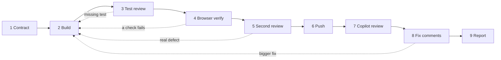

# story-loop

**One command takes a Shortcut story or a GitHub issue to a reviewed draft PR. You sign the plan
at the start, watch it on a live board, and merge at the end.**

```
/story-loop SC-12345        # a Shortcut story
/story-loop gh-123          # a GitHub issue (or paste its URL)
```

> Status: 0.6, experimental. The parts are tested on their own; the whole loop
> has not yet carried a real story. Expect rough edges and tell the author.

## What happens



| # | Stage | What the agent does | What proves it |
| --- | --- | --- | --- |
| 1 | Contract | From the story (`start-story`) or the issue: drafts the PR description, asks about gaps, opens the draft PR | **Your sign-off** |
| 2 | Build | Splits the plan into tasks; worker agents on Haiku, Sonnet or Opus build test-first | The diff, read by the conductor; suites green |
| 3 | Test review | Breaks each changed line on purpose and checks a test notices | The mutant table |
| 4 | Browser verify | A second agent that has not seen the code checks every Test Step in a real browser | A screenshot per check |
| 5 | Second review | Another model tries to break the work: Codex by default, any reviewer CLI you name, or a fresh Claude on another model | Every finding fixed, rejected with a reason, or parked for you |
| 6 | Push | Commits (signed) and pushes the story branch | The commit |
| 7 | Copilot review | Requests GitHub Copilot's review and waits for it | The review |
| 8 | Fix comments | Fixes what is clear, answers every thread | The replies |
| 9 | Report | Posts the results on the PR | The comment; the PR stays a draft |

A later stage can send work back to Build, twice at most. Then it stops and
shows you instead of trying a third time.

## What stays yours

- **Signing the contract.** Nothing is built before you approve the plan.
- **Decisions.** Design questions and anything that contradicts the PR
  description are parked for you, never guessed.
- **Ready for review, approval, merge.** The agent never marks the PR ready
  and never merges. A hook refuses it.

## The board

It opens in your browser when a story starts.

- **Top:** the nine stages as a graph, the current one alive, and an arrow
  when work is sent back, with the reason.
- **Left:** who is working on what right now, the tasks, the review findings
  with their verdicts, and *Tested in the browser*: every check with its
  screenshot.
- **Right, *Understand this change*:** one card per changed file with
  **Explain this**, **Why here?**, **How it connects** and **Show diff**, plus
  a short quiz on the whole change. This is there so you still know your code.
- **Tell the agent:** under any explanation, diff or finding you can write
  "this is wrong" or "do it differently". A working agent picks the note up at
  its next step. If the agent is idle, **Copy handover note** gives you the
  text to paste into Claude.

See it without a story:

```bash
node skills/story-loop/board/server.mjs --demo
```

Then open http://127.0.0.1:4317. It replays a scripted run in about 40 seconds.

## Get started

### 1. Install

```
/plugin install story-loop --marketplace hal-9/claude-mods
```

Start a new Claude Code session afterwards, so the hooks load.

### 2. Let it check your machine

In the repo you work in:

```
/story-loop setup
```

It checks every prerequisite, tells you what is missing and what it is for,
and walks you through each fix. It installs nothing behind your back and never
asks you to paste a password. You can run the check alone too:

```bash
node <plugin>/skills/story-loop/scripts/doctor.mjs
```

### 3. Run a story

```
/story-loop SC-12345        # a Shortcut story
/story-loop gh-123          # a GitHub issue (or paste its URL)
```

Switch the session to Fable 5.2 first (`/model`): the conductor runs on it, and the hook refuses a run it can see starting on another model. Pick a small story with a page to test for the first run.

## What you need

`/story-loop setup` checks the first seven for you. Without Codex the second review still runs, by a fresh Claude on another model; that is weaker than a model from another vendor, and the report says which reviewer was used.

| Needed | For | Get it |
| --- | --- | --- |
| Node 20+ | every script | `brew install node` |
| GitHub CLI, signed in | PR, push, Copilot review | `brew install gh`, `gh auth login` |
| Shortcut CLI 5+ (Shortcut stories only) | reading the story, moving the card | `npm i -g @shortcut-cli/shortcut-cli`, `short install` |
| `start-story` skill in the repo (Shortcut stories only) | stage 1 | synced with the shared skills |
| `.start-story/` gitignored | run files and screenshots stay out of the PR | one line in `.gitignore` |
| Signed commits | the repo requires them | the repo's signed-commits guide |
| Codex plugin, signed in (recommended, not required) | the strongest second review: a model from another vendor | `/plugin install codex@openai-codex`, `/codex:setup` |
| A browser the agent can drive | stage 4 | Chrome with the Claude extension, **or** the BrowserOS app running |
| A test user in that browser | logging in on previews and staging | sign in as a test user, or save its login in the browser; the agent does not type passwords on non-local sites |
| Copilot review enabled on the repo | stage 7 | repository settings |
| The app boots in the test environment | stage 4 | your project's usual setup |

No browser reachable? The loop does not skip the browser check. It stops and
asks you to start one.

## Who thinks with what

| Role | Model | Why |
| --- | --- | --- |
| Conductor: plans, keeps the overview, checks every result | Fable 5.2 | judgment is the scarce part |
| Hard or delicate tasks, the browser verifier, the fallback reviewer | Opus (max effort for the hardest) | needs care, not the overview |
| Standard feature work | Sonnet | clear requirements, few files |
| Mechanical edits, running suites | Haiku | nothing to decide |

This is enforced, not suggested. The four workers carry their model in their
definition. A hook refuses any other delegation that does not name Opus,
Sonnet or Haiku, refuses to start a run from a session on another model, and
blocks switching the session away from Fable while a run is active. The models
are two lines in `skills/story-loop/scripts/graph.json`.

One limit: Claude Code tells hooks the session's model only at session start
and on a switch. If it reports neither, the check cannot see the model and
lets the run start.

## What it will not do

- Push anywhere but the story branch on `origin`. No force-push.
- Merge, or mark the PR ready.
- Skip the browser check or the second review on its own.
- Pass the browser check without a screenshot for every check.
- Rewrite the PR description to match what it built.

The first two are enforced by a hook that reads the command before it runs.
It stops accidents; branch protection on GitHub remains the real boundary.

## How it is built

| Part | File | Does |
| --- | --- | --- |
| Stage graph | `skills/story-loop/scripts/graph.json`, `loop.mjs` | the only moves that exist; state in `.start-story/active.json` |
| Stop gate | `scripts/hook.mjs` (Stop) | the session cannot end while a stage is pending, unless a wait or a block is recorded |
| Push guard | `scripts/hook.mjs` (PreToolUse) | see *What it will not do* |
| Mutants | `scripts/mutate.mjs` | breaks changed lines one at a time; nothing to install |
| Notes | `.start-story/inbox.json`, `scripts/hook.mjs` | carries what you write on the board to the agent |
| Setup check | `scripts/doctor.mjs` | prerequisites and their fixes |
| Board | `board/server.mjs`, `board/index.html` | one local page, no build step, no external requests |
| Conductor | `skills/story-loop/SKILL.md`, `stages/*.md` | the instructions the agent follows |
| Workers | `agents/worker-*.md` | four agents with fixed models |

Everything is plain Node with no dependencies. The build stage is adapted
from [savvy-flow](https://github.com/johnnyvizz/claude-kit) (MIT).

## When something is off

| You see | Do |
| --- | --- |
| The agent stopped and the board says *needs you* | Read the banner: a sign-off, a parked finding or a missing prerequisite |
| A stage says *blocked* | The reason is next to it; fix it and tell the agent to continue |
| The board is empty | No run yet in that repo; it fills once the story starts |
| Worker cards show only the conductor | Your Claude Code version does not pass worker ids to hooks; the run is unaffected |
| You want to stop a run for good | `node <plugin>/skills/story-loop/scripts/loop.mjs end` in the repo |

## Tests

```bash
node --test
```
