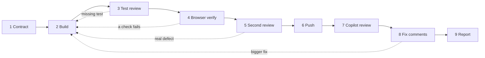

# story-loop

**One command takes a Shortcut story or a GitHub issue to a reviewed draft PR. You sign the plan
at the start, watch it on a live board, and merge at the end.**

https://github.com/user-attachments/assets/41477f16-1996-42d5-bb66-3ca51721f699

```
/story-loop SC-12345        # a Shortcut story
/story-loop gh-123          # a GitHub issue (or paste its URL)
```

> Status: 0.9, experimental, in a supervised pilot. What has been checked, and
> how, are three different things:
>
> - **Fixture tests** (`node --test tests/*.test.mjs`): the parts on their own,
>   against real git, local bare remotes, a fake `gh` and a fake `claude`.
> - **Runtime smoke tests**: the board in a real browser; nothing else yet.
> - **Real story validation**: none yet. The whole loop has not carried a real
>   story, and nothing here has run against the real GitHub, Copilot or CI.
>
> Use it supervised, on a feature branch, and review and merge as you would
> any PR. A green test suite is not a claim that it is bulletproof.

## What happens



| # | Stage | What the agent does | What proves it |
| --- | --- | --- | --- |
| 1 | Contract | From the story (`start-story`) or the issue: drafts the PR description, asks about gaps, opens the draft PR | **Your sign-off** |
| 2 | Build | Splits the plan into tasks; worker agents on Haiku, Sonnet or Opus build test-first | Every task accepted, everything committed |
| 3 | Test review | Breaks each changed line on purpose, in a throwaway copy, and checks a test notices | Mutation results for this exact code: killed, survived, invalid, timed out |
| 4 | Browser verify | A second agent that has not seen the code checks every Test Step in a real browser | Every check of the matrix you approved, once, with a real screenshot |
| 5 | Second review | Another model tries to break the work: Codex by default, any reviewer CLI you name, or a fresh Claude on another model | Every finding with a severity: fixed with its commit, rejected with a reason, or parked for you |
| 6 | Push | Publishes the checked commit to the story branch, nothing else | The remote read back at that commit |
| 7 | Copilot review | Requests GitHub Copilot's review and waits for it, with a deadline | A Copilot review of exactly that commit |
| 8 | Fix comments | Triages every comment, answers every thread; any code change goes back to Build | Every comment settled |
| 9 | Report | Posts the results on the PR | Required CI green on the final commit; one report comment; the PR stays a draft |

A later stage can send work back to Build, twice at most. Then it stops and
shows you instead of trying a third time. Going back makes the earlier tests,
browser checks and reviews stale: they run again on the new code, and the old
results stay in the run's history.

## What stays yours

- **Signing the contract.** Nothing is built before you approve the plan.
- **Decisions.** Design questions and anything that contradicts the PR
  description are parked for you, never guessed.
- **Ready for review, approval, merge.** The agent never marks the PR ready
  and never merges. A hook refuses it.

## The board

It opens in your browser when a story starts.

- **Top:** the nine stages as a graph, the current one alive, and an arrow
  when work is sent back, with the reason.
- **Left:** who is working on what right now, the tasks, the review findings
  with their verdicts, and *Tested in the browser*: every check with its
  screenshot.
- **Right, *Understand this change*:** one card per changed file with
  **Explain this**, **Why here?**, **How it connects** and **Show diff**, plus
  a short quiz on the whole change. This is there so you still know your code.
- **Tell the agent:** under any explanation, diff or finding you can write
  "this is wrong" or "do it differently". A working agent picks the note up at
  its next step. If the agent is idle, **Copy handover note** gives you the
  text to paste into Claude. A copied note stays open until the agent has
  received and handled it, so nothing is lost if you never paste it.
- **Honest states:** checks count against the matrix you approved (1 of 20,
  never 1 of 1); evidence from older code is marked stale; a stage that cannot
  go on says why.

See it without a story:

```bash
node skills/story-loop/board/server.mjs --demo
```

Then open http://127.0.0.1:4317. It replays a scripted run in about 40 seconds.

## Get started

### 1. Install

```
/plugin install story-loop --marketplace hal-9/claude-mods
```

Start a new Claude Code session afterwards, so the hooks load.

Developed and tested with Claude Code 2.1.317. The one-step `--marketplace`
install above is documented for 2.1.275 and later; that says nothing about
the rest. What the plugin needs from Claude Code: plugin hooks for
`PreToolUse`, `PostToolUse`, `PostToolUseFailure`, `Stop`, `SubagentStart`,
`SubagentStop`, `SessionStart`, `SessionEnd`, `PreModelSwitch` and
`PostModelSwitch`; `session_id` (and `agent_id` for workers) in hook input;
plugin-defined agents with a fixed model; and `claude -p --tools` for the
board's explainer. On an older version some of these do nothing, silently:
the run still works, with weaker guards.

### 2. Let it check your machine

In the repo you work in:

```
/story-loop setup
```

It checks every prerequisite, tells you what is missing and what it is for,
and walks you through each fix. It installs nothing behind your back and never
asks you to paste a password. You can run the check alone too:

```bash
node <plugin>/skills/story-loop/scripts/doctor.mjs
```

### 3. Run a story (or continue one)

```
/story-loop SC-12345        # a Shortcut story
/story-loop gh-123          # a GitHub issue (or paste its URL)
```

Switch the session to Fable 5.2 first (`/model`): the conductor runs on it, and the hook refuses a run it can see starting on another model. Pick a small story with a page to test for the first run.

A run belongs to the session that drives it. To continue in a new session, run
`/story-loop` again there: it takes the run over with `loop.mjs acquire` once
the old session has been quiet for 15 minutes (or at once, when you say so).

### 4. Record a run (optional, for the pilot)

To study a run afterwards, ask for a recorded one. It is off by default.

```
/story-loop SC-12345 and record diagnostics
```

or, by hand, in the repo:

```bash
node <plugin>/skills/story-loop/scripts/loop.mjs init SC-12345 --diagnostics   # from the start
node <plugin>/skills/story-loop/scripts/loop.mjs diagnostics on                # or part way; what came before is marked missing
node <plugin>/skills/story-loop/scripts/loop.mjs diagnostics status
node <plugin>/skills/story-loop/scripts/loop.mjs diagnostics export            # the active run
node <plugin>/skills/story-loop/scripts/loop.mjs diagnostics export --run <run id>   # any earlier run, also after `end` or a new story
```

The export is one folder (it prints where): `summary.md`, `manifest.json`,
`events.jsonl`, the run state and the run's files with their hashes. Give that
folder to an agent and have it read `summary.md` first; it ends with the
prompt for the analysis. Add `--screenshots` to include the browser
screenshots.

- Recording changes no decision. If a record cannot be written the run goes
  on, warns once, and the export says the recording is incomplete.
- Secrets (tokens, passwords, cookies, credentials in URLs) are redacted
  before anything is written. Full transcripts are never recorded.
- Nothing is uploaded or posted. It stays under
  `.start-story/<story>/diagnostics/<run id>/`, which is gitignored with the
  rest of `.start-story/`.
- It says what it does not know: a tool call with no recorded end, a helper
  that never reported, a line cut off part way, a version that could not be
  read. It does not fill those in.

## What you need

`/story-loop setup` checks the first seven for you. Without Codex the second review still runs, by a fresh Claude on another model; that is weaker than a model from another vendor, and the report says which reviewer was used.

| Needed | For | Get it |
| --- | --- | --- |
| Node 20+ | every script | `brew install node` |
| GitHub CLI, signed in | PR, push, Copilot review | `brew install gh`, `gh auth login` |
| Shortcut CLI 5+ (Shortcut stories only) | reading the story, moving the card | `npm i -g @shortcut-cli/shortcut-cli`, `short install` |
| `start-story` skill in the repo (Shortcut stories only) | stage 1 | synced with the shared skills |
| `.start-story/` gitignored | run files and screenshots stay out of the PR (a blocker if not) | one line in `.gitignore` |
| Signed commits, if the repo requires them | the publisher refuses unsigned commits when signing is on; setup signs a throwaway commit to prove it works | the repo's signed-commits guide |
| Codex plugin, signed in (recommended, not required) | the strongest second review: a model from another vendor | `/plugin install codex@openai-codex`, `/codex:setup` |
| A browser the agent can drive | stage 4 | Chrome with the Claude extension, **or** the BrowserOS app running |
| A test user in that browser | logging in on previews and staging | sign in as a test user, or save its login in the browser; the agent does not type passwords on non-local sites |
| Copilot review enabled on the repo | stage 7 | repository settings |
| The app boots in the test environment | stage 4 | your project's usual setup |
| A local server of the app, started from the checkout | stage 4 tests the code under review only when the page is served from it; a staging or preview site usually still has older code at that point | your project's dev server; a deployment counts only when it reports the commit it serves |

No browser reachable? The loop does not skip the browser check. It stops and
asks you to start one.

## Who thinks with what

| Role | Model | Why |
| --- | --- | --- |
| Conductor: plans, keeps the overview, checks every result | Fable 5.2 | judgment is the scarce part |
| Hard or delicate tasks, the browser verifier, the fallback reviewer | Opus (max effort for the hardest) | needs care, not the overview |
| Standard feature work | Sonnet | clear requirements, few files |
| Mechanical edits, running suites | Haiku | nothing to decide |

This is enforced, not suggested. The four workers carry their model in their
definition. A hook refuses any other delegation that does not name Opus,
Sonnet or Haiku, refuses to start a run from a session on another model, and
blocks switching the session away from Fable while a run is active. The models
are two lines in `skills/story-loop/scripts/graph.json`.

One limit: Claude Code tells hooks the session's model only at session start
and on a switch. If it reports neither, the check cannot see the model and
lets the run start.

## What it will not do

| Promise | How | Where it ends |
| --- | --- | --- |
| Publish only the story branch: no force, no tags, no other refs | Raw `git push` is refused by a hook; `publish.mjs` pushes `<checked commit>:refs/heads/<branch>` to a remote with exactly one push URL, then reads it back | A disguised command (`sh -c "$(…)"`) or another tool can get past a hook that reads command text; branch protection on GitHub is the firm boundary |
| Publish only to the run's repository, never to the base or default branch | Before the first write the push URL is read as `owner/name` (ssh or https) and compared with the run's repository; the story branch is compared with the recorded base and with the default branch the remote reports | Only github.com URLs are recognised; an SSH host alias or GitHub Enterprise host is refused, not supported. Forks are refused |
| Never merge, never mark the PR ready | The hook refuses `gh pr merge`, `gh pr ready` and the GraphQL/REST spellings, with or without `--repo` | Same as above |
| A stage looks done only when it is | Every pass is checked against its evidence (`loop.mjs passProblem`); browser checks against the approved matrix, screenshots as complete image files in the evidence folder; the last stage checks everything again | The agent writes the evidence files; the checks catch omissions, stale and fake files, not a deliberate forgery. Screenshots are checked to be whole files, not to show what they claim |
| Old evidence never passes new code | Browser results carry a request id made before the browser ran (run, attempt, check list, environment, code tree); a review is recorded under a request made before the reviewer ran, for the code tree that request named; a later commit makes all of it stale, and the publisher refuses to push such a commit | Equivalent code reached by a different tree counts as new; the same tree under another commit counts as the same code. Code changed while the browser ran and put back before the pass is not seen. An old review answer that was never recorded could still be handed in under a new request |
| Work that finishes late changes nothing | Mutants, the Copilot wait, CI, comments, the report and the publisher note the run and attempt they started in and are checked against it, under the lock, before their result is recorded; a late result is kept under `stale/`; `end` asks running helpers to stop | A push or a comment that already reached GitHub stays there: it is recorded for the run that made it and has to be reconciled by hand |
| A browser pass means the reviewed code | The environment is recorded before the browser runs: a local server from the checkout, or a deployment with the commit it reports (refused when that is another commit). Every result names its final URL, its environment, its step and case | A local server is the agent's word that it runs this checkout. A deployment nothing ties to the code passes only on your word and is marked "not exact code" on the board and in the report |
| Mutation results mean something | The scope is the diff, not the files the agent names; a kill needs a mutant that was checked to parse; survivors, timeouts and mutants not run each need a recorded reason | Mutants are textual, one operator per line, at most `--max` per call; ts/tsx/jsx are checked only with the project's `typescript`; templates and styles are named, not mutated |
| GitHub steps act on this PR only | Every `gh` call names the run's repository; the PR's branch, base and head are checked against the run before CI is read and before the report is posted | PRs from forks are refused, not supported |
| Green CI means the required checks | Checks are recorded only for the published commit, with where the required set came from. A 404 or 403 on the policy is `unknown`, never "nothing required"; the list you name is kept for that repository and base, added to what the policy shows, and looked up among all checks. A required check GitHub has not created yet is pending | The list you name is your word. Rulesets that cannot be read (also on a GitHub without rulesets) leave the policy unknown until you name the list |
| No lost or crossed state | One lock around every write and around `init`, `end` and `recover`; atomic file replace for state and notes, last good copy kept (`loop.mjs recover`); a file that parses but is not a run or a list of notes is as unreadable as a cut-off one, and only a valid backup is restored | Local processes only; not a database |
| The board shows what the gate decided | The board asks the same function the gate uses, row by row: only checks accepted for the current request are counted, and "all passed" needs the gate's yes | The page is checked by hand in a browser, not by an automated UI test |
| Notes survive a change of session | A note handed to a session that never finished it is handed to the next owner once, under the same id; `loop.mjs inbox` lists everything not done | A note is "handed over" when a hook put it into the session's context; whether the agent acted on it is the `note done` record |
| One conductor at a time | A lease renewed by every hook call of the owning session, its workers' included; `acquire` takes over an expired one; after a takeover the old session's file edits are refused | Ownership is by Claude Code session id. One tool call longer than 15 minutes with nothing else running lets the lease expire. An old session's shell command that changes files is not caught |
| Not skip the browser check or the second review on its own | Skips need the human's word (`human:` reason) | That reason is the agent's word, not proof |
| Not rewrite the PR description to match what it built | Instructions | Instructions |
| Explanations on the board change nothing | `claude -p --tools Read,Grep,Glob --strict-mcp-config`, killed when you close it or after 3 minutes, two at a time | Hooks and settings of your Claude Code still apply to it |

## How it is built

| Part | File | Does |
| --- | --- | --- |
| Stage graph | `skills/story-loop/scripts/graph.json`, `loop.mjs` | the only moves that exist, the evidence each pass needs; state in `.start-story/active.json` |
| Stop gate | `scripts/hook.mjs` (Stop) | the session cannot end while a stage is pending; after four tries it records the stage as blocked |
| Guard and ownership | `scripts/hook.mjs` (PreToolUse) | see *What it will not do* |
| Publisher | `scripts/publish.mjs` | the only push of a run |
| GitHub steps | `scripts/github.mjs` | Copilot request and bounded wait, comments, required CI, the report comment — each recorded so a retry reconciles |
| Mutants | `scripts/mutate.mjs` | breaks changed lines one at a time in a throwaway worktree; nothing to install (uses the project's `typescript` when it has one) |
| Notes | `.start-story/<story>/inbox.json`, `scripts/hook.mjs` | carries what you write on the board to the agent |
| Setup check | `scripts/doctor.mjs` | prerequisites and their fixes |
| Diagnostics | `scripts/diag.mjs` | opt-in record of a run and its export; decides nothing |
| Board | `board/server.mjs`, `board/index.html` | one local page, no build step, no external requests |
| Conductor | `skills/story-loop/SKILL.md`, `stages/*.md` | the instructions the agent follows |
| Workers | `agents/worker-*.md` | four agents with fixed models |

Everything is plain Node with no dependencies. The build stage is adapted
from [savvy-flow](https://github.com/johnnyvizz/claude-kit) (MIT).

## When something is off

| You see | Do |
| --- | --- |
| The agent stopped and the board says *needs you* | Read the banner: a sign-off, a parked finding or a missing prerequisite |
| A stage says *blocked* | The reason is next to it; fix it and tell the agent to continue |
| `the run state ... is unreadable` | `node <plugin>/skills/story-loop/scripts/loop.mjs recover` restores the last good copy; pushes and PR changes wait until then |
| `run ... belongs to session ...` | Another session owns the run; `loop.mjs acquire` in the new one (after 15 quiet minutes, or `--takeover "<why>"`) |
| A run from 0.6 | It migrates on first use and keeps its data; stages it already passed carry no code tree, so they count as stale and the run goes back to build for fresh evidence |
| A run started on 0.7 | Finish it on 0.7 or end it: browser results now need a request id (`loop.mjs start verify` again), the review is recorded with `loop.mjs review`, and mutation results need a fresh `mutate.mjs` run |
| `the notes file ... is unreadable` | `loop.mjs recover` restores the last good copy and keeps the broken file next to it; a note typed after that copy is only in the broken file |
| `required CI ... unknown` | The base branch's required checks could not be read (no permission, or GitHub answered 404); tell the agent which checks are required. Ask again after changing the base |
| A run started on 0.8 | End it and start again on 0.9: verify now needs a recorded environment and results with their URL, the review needs `start second_review` and `--request`, and the publisher needs the base recorded first |
| `the push URL ... is not a GitHub repository story-loop can identify` | The remote uses an SSH host alias, another host, or a fork; point `origin`'s push URL at `git@github.com:<owner>/<name>` of the run's repository |
| `this ... finished for ... but ...; its result changes nothing here` (exit 4) | A helper outlived its run or its attempt; its result is in `.start-story/<story>/stale/`. Nothing to fix: run the step again for the current attempt |
| `record where the browser will test` | Start the app from the checkout and record it: `loop.mjs put environment '{"url":"http://127.0.0.1:3000","kind":"local"}'` |
| The board is empty | No run yet in that repo; it fills once the story starts |
| Worker cards show only the conductor | Your Claude Code version does not pass worker ids to hooks; the run is unaffected |
| You want to stop a run for good | `node <plugin>/skills/story-loop/scripts/loop.mjs end` in the repo; the run's record stays in `.start-story/<story>/` |

## Tests

```bash
node --test tests/*.test.mjs
```

These are fixture tests: real git, bare repositories on disk standing in for
GitHub, a fake `gh`, a fake `claude`. They do not start Claude Code, a browser
or anything on github.com.

Three tests need a `typescript` package (the compiler-present branch of the
mutation runner). story-loop has no dependencies, so without one they are
reported as **skipped**, not passed. To run them, point at any `node_modules`
that has typescript:

```bash
STORY_LOOP_TEST_NODE_MODULES=/path/to/some/project/node_modules node --test tests/*.test.mjs
```
